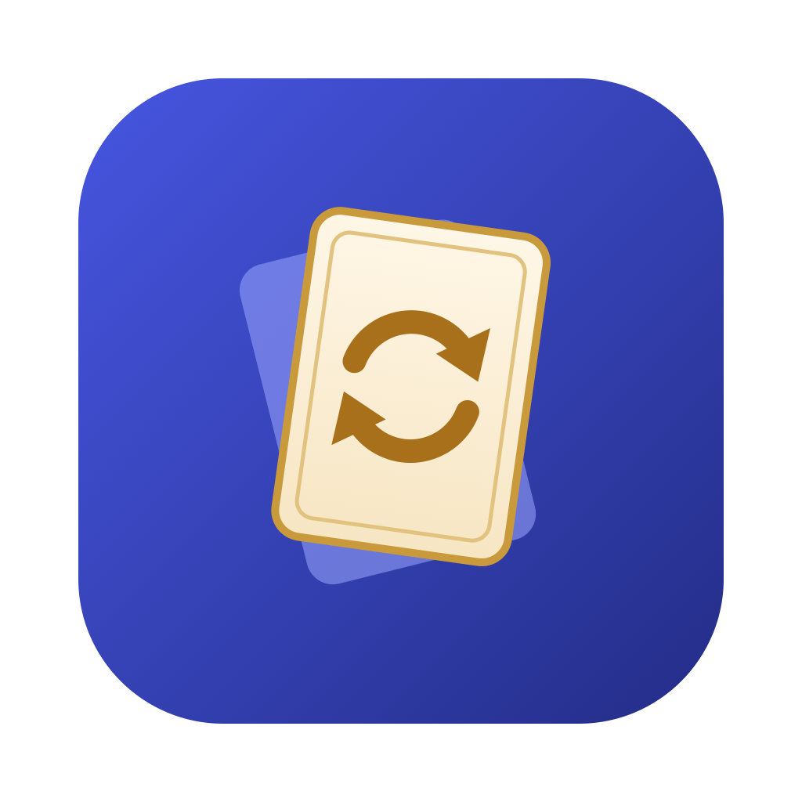

<p align="center"></p>

<h1 align="center">AI Lottery · Reroll</h1>

<p align="center">Spot a bad AI session in the first two minutes.<br>Hand the work to a fresh one when it goes dumb — without losing anything.</p>

<p align="center"><a href="../../releases/latest">Download</a> · macOS (Apple Silicon / Intel) · Windows (x64 / ARM64)</p>

---

## Why

Open a new AI session — Claude Code, ChatGPT, anything — and sometimes it's sharp, sometimes it's dull, and it gets duller the longer you go. Three causes stack on top of each other:

| Layer | Cause | Remedy | Tool |
|---|---|---|---|
| 1 Opening | Server routing, load, reasoning effort — and routing is sticky | Test first; reroll bad draws | `/canary` + scorer |
| 2 First ~10 turns | The model locks in its reading of your intent early and rarely revisits it | After passing, roll back to before the test: a clean start | `/rewind` |
| 3 Later on | The context fills with the model's own mistakes | Remove pollution instead of adding corrections; if it can't be saved, swap sessions | `/compact` `/handoff` `/pickup` |

The key idea: **your work lives in files and git, not in the session.** Sessions are disposable.

The app explains the evidence and walks through every step.

## Download

From [Releases](../../releases/latest):

| Your computer | File | Install |
|---|---|---|
| Mac with Apple Silicon (M1 and later) | `Reroll-<version>-mac-arm64.dmg` | Open, drag Reroll into Applications |
| Mac with Intel | `Reroll-<version>-mac-x64.dmg` | Same |
| Windows PC (most PCs) | `Reroll-<version>-win-x64.zip` | Unzip anywhere, run `Reroll.exe` |
| Windows on ARM (Snapdragon, Surface Pro X, …) | `Reroll-<version>-win-arm64.zip` | Same |

- macOS 12 or later. Signed with Developer ID and notarized by Apple: double-click and it opens. A `.zip` of each Mac build is there too.
- Windows 10 or later. The Windows builds are portable and not code-signed yet, so SmartScreen may say "Windows protected your PC": click **More info → Run anyway**. Nothing is installed; delete the folder to remove it.
- Not sure which Mac you have:  → About This Mac → "Chip" says Apple M… or Intel.

## What's inside

- **Why it happens** — the three layers, the evidence, the remedies
- **Scorer** — pick a score for each answer to `/canary`; get good / so-so / bad
- **One-click install** — puts the `canary`, `handoff` and `pickup` skills into `~/.claude/skills/`
- **Chat prompts** — copy-paste versions for ChatGPT and other web chats
- **Export** — save the whole kit as a folder to share or drop into a project
- **English and Chinese** — English by default; switch in the sidebar

No app needed: the kit itself is in [`kit/en/`](kit/en/) (Chinese: [`kit/zh/`](kit/zh/)). See [`kit/en/README.md`](kit/en/README.md) to install by hand.

## Safety

| Part | What it does | Safeguards |
|---|---|---|
| `/canary` | The AI answers in text only | Runs no commands; creates, modifies, deletes no files |
| `/handoff` | Read-only git commands; writes one `HANDOFF.md` | Asks before touching a same-name file in another format; never commits |
| `/pickup` | Reads `HANDOFF.md`; read-only git commands | Changes nothing until you confirm |
| App: Install | Writes only three folders under `~/.claude/skills/` | Shows the plan first; existing same-name skills move to `~/.claude/skills-backup/<time>/`; never deletes |
| App: Export | Creates a new subfolder where you choose | Never overwrites |
| App: Running | One window | No network, no permissions, no background processes; sandboxed renderer with context isolation; Electron fuses disable RunAsNode and friends |

## Development

```bash
npm install
npm start               # run
npm test                # unit tests: install / export logic, both languages
npm run smoke           # real Electron, both languages: every page, scorer, install (temp HOME), zero network requests
npm run icon            # regenerate build/icon.icns, icon.ico, icon.png from build/icon.svg
npm run dist:unsigned   # local package, unsigned
npm run dist            # all four targets; macOS signed + notarized → out/
npm run dist -- --target mac-arm64,win-x64   # only some targets
```

`npm run dist` needs a `Developer ID Application` certificate in the keychain and a notarytool keychain profile (default name `reroll-notary`):

```bash
xcrun notarytool store-credentials reroll-notary --apple-id <Apple ID> --team-id <Team ID>
```

Override with `REROLL_SIGN_IDENTITY` and `REROLL_NOTARY_PROFILE`.

## Layout

```
main.js        main process: window, IPC, no network, denies all permission requests
preload.js     exposes only the six window.kit methods
ops.js         plain-Node file operations (install plan / install / export), unit-tested
renderer/      UI; prose pages per language, interactive text in app.js
kit/en, kit/zh the kit shipped with the app, one folder per language (also the install source)
build/         icon, signing entitlements, build scripts
test/          unit tests + Electron smoke test
```

## License

[MIT](LICENSE)
